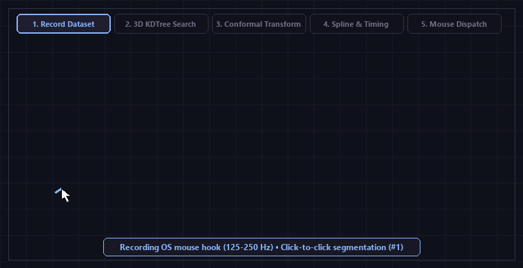
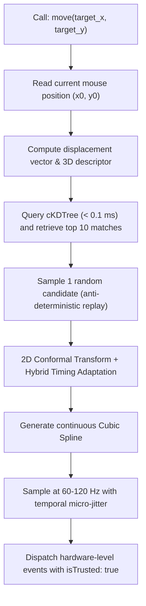
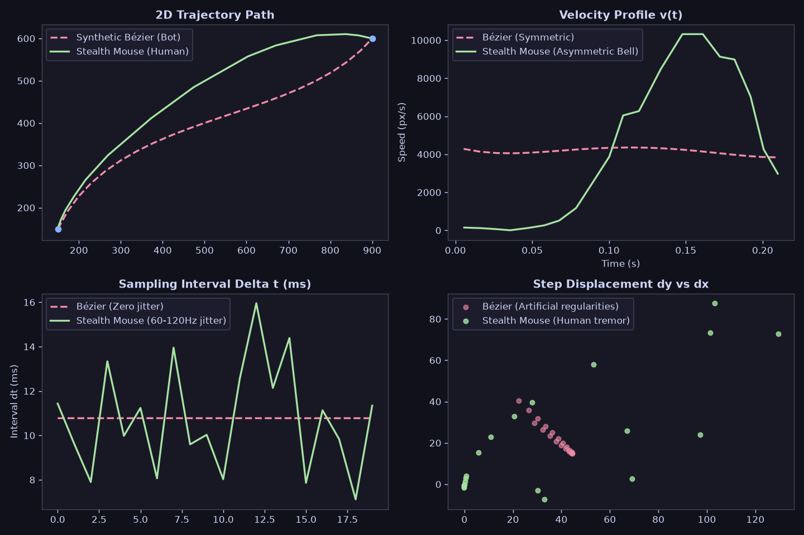

# Stealth Mouse

Human-like mouse trajectory generation and conformal transformation designed for modern anti-bot evasion (Cloudflare Turnstile, DataDome, Kasada, Akamai).

<p align="center">
  
</p>

Instead of generating synthetic mathematical curves (such as Bézier or Perlin noise, which lack natural physiological tremor and exhibit detectable statistical regularities), **Stealth Mouse** retrieves real recorded human gestures and applies conformal transformations to fit arbitrary target coordinates while preserving micro-corrections and biomechanical kinematics.

---

## 1. Record Dataset (Recorder)

Record your own daily mouse movements to populate or expand your database:

```bash
python -m src.recorder
```

* **Pause / Resume:** Press `p`.
* **Save & Exit:** Press `Esc`, `q`, or `Ctrl+C`.

Strokes are automatically segmented click-to-click, idle dead pauses are discarded, and data is accumulated into two complementary files in `data/`:
1. `data/trajectories_index.npz`: 3D descriptors `[log(d), cos(θ), sin(θ)]` and offsets for the KDTree.
2. `data/trajectories_points.npz`: Contiguous high-frequency coordinate bank `[x, y, t]` accessed in $O(1)$ time.

---

## 2. Playback Movements (Super-Minimalist API)

### Python API (4 to 5 letters + coordinates):

```python
from main import move, click

# Moves cursor from its current position to (x, y) with human kinematics
move(800, 450)

# Moves to (x, y) and performs a click with natural human dwell time
click(800, 450)
```

### Direct CLI Usage:

```bash
python main.py 800 450
python main.py click 800 450
```

---

## 3. Interactive Visual Verification

To verify that the cursor moves realistically and hits coordinates with pin-point accuracy, launch the maximized visual target range:

```bash
python example.py
```

* **Pre-rendered numbered bullseyes:** Targets appear on screen **before** motion begins so you can verify accuracy.
* **Random rounds:** Click the **`🎲 Generate Random`** button (or press `r`) to generate new non-overlapping targets on the fly.

---

## 4. Architecture & How It Works



### Key Technical Innovations:

1. **3D Spatial Descriptor:** Each stroke is indexed as $[\log(\text{distance}),\ \cos(\theta),\ \sin(\theta)]$. Using $(\cos,\sin)$ eliminates periodic angular discontinuity ($0^\circ \leftrightarrow 360^\circ$), while $\log(\text{distance})$ ensures scale-invariant proportional matching.
2. **Hybrid Temporal Adaptation:**
   * **Close matches ($<15\%$ distance difference):** Uses **100% pure human recorded time**, without synthetic formulas.
   * **Large stretches ($2\times, 3\times$ distance disparity):** Applies smooth exponential damping via **Fitts's Law** ($MT \propto \log_2(1 + D/W)$) to prevent hyperspeed or slow-motion artifacts.
3. **Continuous Spline Densification:** Evaluates coordinates at realistic display refresh rates (60–120 Hz / 8–16 ms intervals) with subtle temporal jitter, replicating native hardware polling.
4. **Browser & Native OS Ready:** Compatible with native desktop automation (`pynput`) as well as headless/stealth browser frameworks (`Playwright` / CDP) with `isTrusted: true` event dispatch.

---

## 5. Testing & Verification Suite

A complete verification suite is provided under [`tests/`](file:///d:/stealth_mouse/tests) to mathematically and functionally prove anti-bot evasion properties:

```bash
# Run full automated test suite (12 tests)
pytest -v tests

# Or run specific test modules directly:
python tests/test_core.py                 # KDTree, Conformal Transforms, Splines, Path generation
python tests/test_kinematics.py           # Asymmetric velocity bell curves, micro-tremors vs Bézier
python tests/test_browser.py              # Headless Playwright integration & isTrusted: true checks
python tests/test_interactive_browser.py  # Visible browser UI: Sandbox & Cloudflare Turnstile
```

* **`tests/test_interactive_browser.py`:** Opens a **visible Chromium window (`headless=False`)** to directly watch cursor trajectories in real time:
  * Run `--sandbox` for the live Biometric Telemetry Dashboard (displays canvas trail, speed, jitter, and real-time Anti-Bot classification).
  * Run `--turnstile` for a live test on a real **Cloudflare Turnstile** challenge page.
* **`tests/test_core.py`:** Tests KDTree sub-millisecond querying, conformal boundary preservation, and hybrid temporal blending.
* **`tests/test_kinematics.py`:** Benchmarks `stealth_mouse` against naive synthetic Bézier curves, verifying biological acceleration/deceleration phases and hardware polling jitter ($\Delta t$). Also saves a visual diagnostic plot to `tests/kinematics_comparison.png`.
* **`tests/test_browser.py`:** Launches headless Chromium via Playwright, listens to DOM JavaScript events, and verifies `event.isTrusted === true`, discrete trajectory events, and realistic human dwell time (45–130 ms).

### Biometric Validation (Synthetic Bézier vs. Stealth Mouse):

<p align="center">
  
</p>

* **Velocity Profile $v(t)$:** Bézier curves are unnaturally symmetric, whereas Stealth Mouse exhibits human-like rapid acceleration followed by a prolonged deceleration phase with terminal micro-corrections.
* **Sampling Interval $\Delta t$:** Naive scrapers use fixed delays (zero variance), while Stealth Mouse models authentic hardware polling jitter (60–120 Hz / 8–16 ms).
* **Kinematic Phase Plane:** Anti-bot ML classifiers detect the rigid geometric regularity of Bézier math on $(dx, dy)$ scatter plots, whereas real human tremor displays physiological dispersion.

---

## Installation

```bash
pip install -r requirements.txt
```

### Dependencies:
* `numpy` (vectorized matrix operations & conformal transformations)
* `scipy` (`cKDTree` spatial index in C++ and continuous `CubicSpline`)
* `pynput` (OS-level low-level mouse and keyboard hooks)
* `playwright` (async browser automation driver)
* `matplotlib` (visual target suite and kinematic analysis)