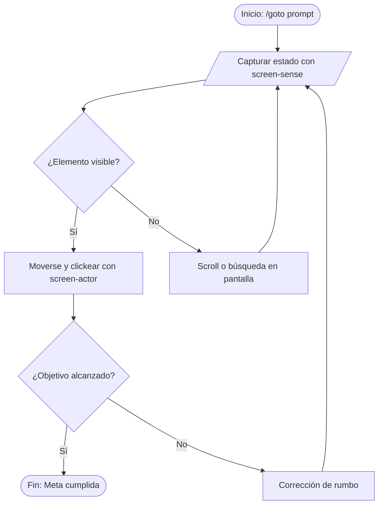

# Flowchart: Visual Architecture & Diagramming Protocol

The `flowchart` skill defines standard patterns for producing error-free, visually expressive diagrams in Mermaid and Generative UI artifacts.

## Syntax Guidelines & Hard Rules

To prevent rendering breakages across AI agent interfaces:
1. **Always quote node labels with special characters:**
   * ✅ `id["Process (Step 1)"]`
   * ❌ `id[Process (Step 1)]` *(Will crash parser due to unquoted parentheses)*
2. **Avoid raw HTML tags:** Use clean text, emojis, or Markdown within quoted labels.
3. **Supported diagram starters:**
   * `flowchart TD` (Top-down processes, workflows, decision trees)
   * `flowchart LR` (Horizontal pipelines, data flows, timelines)
   * `sequenceDiagram` (Multi-actor message exchange, protocols)
   * `stateDiagram-v2` (State machines, lifecycle transitions)

## Semantic Node Shapes

- `[Standard Action / Task]` -> `id["Acción o Proceso"]`
- `{"Decision / Condition"}` -> `id{"¿Cumple condición?"}`
- `(["Start / End Milestone"])` -> `id(["Inicio / Fin"])`
- `[("Database / Storage")]` -> `id[("Almacén de Datos")]`
- `[/"User Input / Sensor"/]` -> `id[/"Captura de Pantalla"/]`

## CLI Syntax Validator

Before presenting complex diagrams, validate them:
```bash
python "$env:USERPROFILE\.gemini\config\skills\flowchart\scripts\validate.py" "flowchart TD\n  A --> B"
# (Or local: python skills/flowchart/scripts/validate.py "flowchart TD...")
```

## Example Pattern



